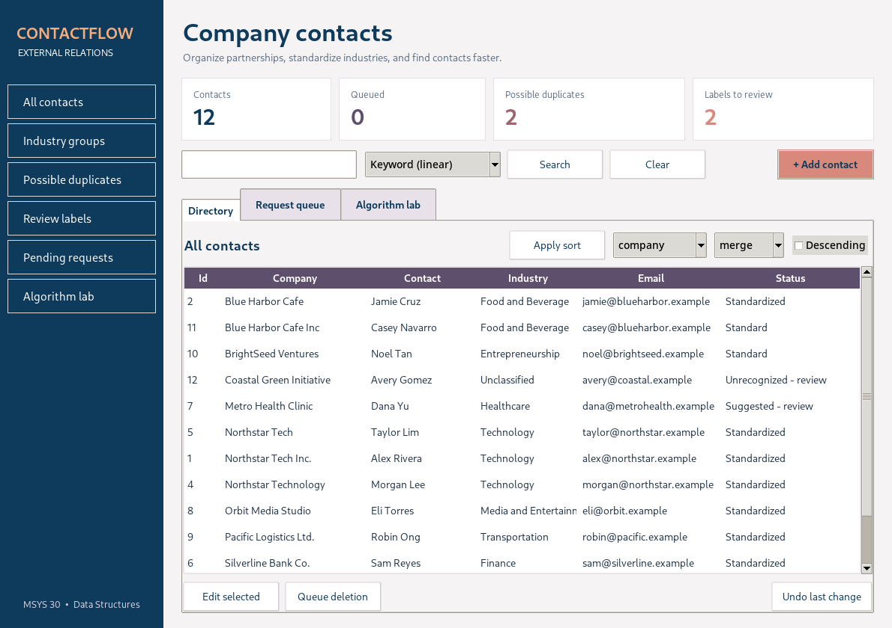

**ATENEO DE MANILA UNIVERSITY**

School of Management / MSYS 30

**FINAL PROJECT REPORT**

**EXTERNAL RELATIONS  
CONTACT MANAGEMENT SYSTEM**

Efficient Sorting, Searching, and Labeling of Company Records

**Prepared by**

Bueno, Dylan  
Malhabour, Amado

Based on the approved project proposal and Coding Assignment 2

MSYS 30 - Data Structures and Algorithms \| SY 2026-2027, Semester 1

20 November 2026

# Table of Contents

Structured in the formal cover-and-section format of the supplied BADBytes Final Deliverable; contents reflect the MSYS 30 project specifications rather than copying MSYS 41 deliverable requirements.

| **Report Section**                                          | **Page** |
|-------------------------------------------------------------|----------|
| Abstract and Keywords                                       | 3        |
| I. Background and Problem Statement                         | 3        |
| II\. Objectives and Scope                                   | 3        |
| III\. Functional and Non-Functional Requirements            | 4        |
| IV\. System Design and Data Structures                      | 5        |
| V. Algorithms and Correctness                               | 6        |
| VI\. Implementation and User Walkthrough                    | 7        |
| VII\. Testing Procedures and Results                        | 8        |
| VIII\. Complexity and Performance Analysis                  | 9        |
| IX\. Design Trade-offs, Limitations and Future Enhancements | 11       |
| X. Conclusion                                               | 11       |
| References                                                  | 11       |
| Appendix A. Execution Guide                                 | 12       |
| Appendix B. Demonstration Plan                              | 12       |

Deliverables: Python program and Tkinter UI, report (DOCX/PDF), presentation (PPTX/PDF), fictional sample CSV, and benchmark results.

Privacy note: All bundled demonstration company/person names and e-mail addresses are fictional. The GDG workbook mentioned in Coding Assignment 2 was not provided as input to this final build.

# Abstract and Keywords

This project implements an external-relations contact management system for an organization whose company and contact records may contain inconsistent industry labels, repeated company names, and incomplete data. The Python desktop and console application provides record addition, editing, deletion, viewing, sorted listings, exact and keyword searches, industry grouping, duplicate-review reports, one-step undo, CSV import/export, and JSON persistence. It explicitly retains the singly linked FIFO request queue and array-backed LIFO undo stack from Coding Assignment 2. Two primary algorithms are added: stable recursive merge sort for ordering and duplicate detection, and binary search (iterative and recursive) for exact normalized company lookup. Supporting algorithms from the original project proposal include linear search, quicksort, and three elementary sorting baselines for comparison. Thirty-one automated tests (28 core and 3 interface smoke tests) passed, and deterministic experiments compare sorting operations and search effort. The resulting system demonstrates how elementary data structures and algorithms can improve organization and retrieval while keeping ambiguous classifications and duplicate flags subject to human review.

Keywords: data structures; algorithms; merge sort; binary search; FIFO queue; stack; CRM; industry taxonomy; duplicate detection; contact management.

# I. Background and Problem Statement

An organization’s external-relations or marketing cluster needs reliable access to partner-company records, contact persons, and sector information. When several members enter records over time, small naming differences produce inconsistencies: “IT,” “Information Technology,” and “Tech” may be interpreted as separate industries, while names such as “Blue Harbor Cafe” and “Blue Harbor Cafe Inc.” may describe the same company. Manual scanning also becomes increasingly slow as the list expands. These problems are identified explicitly in the submitted final-project proposal \[1\].

A practical solution should preserve all original inputs, display standard categories when equivalence is known, surface uncertain labels for review, and identify possible duplicate names without deleting data automatically. Users also need a simple way to find records, manage updates, and reverse an accidental edit. This is an information-systems problem because the value of the database depends not only on storage, but also on consistent access, organization, and integrity.

## Related Foundations

The project applies the lectures on stacks and queues \[3\], recursion \[4\], searching \[5\], and sorting \[6-7\]. The queue supplies an order-preserving processing policy, while the stack supports last-action rollback. The merge sort module motivates stable divide-and-conquer sorting; the search module distinguishes linear scanning from binary search on sorted data. The system does not require a graph or heap because its core task is record retrieval rather than path finding or prioritized task dispatch.

# II. Objectives and Scope

The general objective is to build and evaluate a usable contact-management system that reduces manual effort in storing, searching, sorting, and categorizing external company records.

1.  Add, edit, delete, and view records containing company, contact person, industry, optional email, and notes.

2.  Organize records by company, contact, industry or email, with ascending/descending order.

3.  Look up normalized company names using binary search and find free-text keywords by linear search.

4.  Group companies by standardized industry and flag unknown/missing labels and possible duplicates.

5.  Reuse a FIFO queue for pending changes and a LIFO stack to undo completed changes.

6.  Import/export CSV, save/load JSON, validate inputs, and document measured efficiency.

Scope boundary. ContactFlow is a local, single-user Python information-system prototype with a graphical Tkinter dashboard and an optional console interface. It does not provide live shared storage, access control, automated record merging, edit-distance fuzzy matching, encrypted storage, or external API connections. Multi-user access, trie autocomplete, hash-based indexing, and machine-learning classification remain out of scope.

# III. Functional and Non-Functional Requirements

The requirements in Table 1 translate the proposed features into observable functionality. A Tkinter desktop interface was chosen to improve usability; the console interface remains available for algorithm demonstrations.

| **ID** | **Required behavior**                       | **Implementation / demonstration**                                                  |
|--------|---------------------------------------------|-------------------------------------------------------------------------------------|
| FR-01  | Create, edit, delete, view company contacts | Tkinter forms, selected-row edit/delete, FIFO request processing; CLI also provided |
| FR-02  | Sort by multiple fields, both directions    | merge_sort()/quick_sort(); company/contact/industry/email                           |
| FR-03  | Exact and keyword search                    | exact_search() with cached index; keyword_search()                                  |
| FR-04  | Normalize labels and group by industry      | classify_industry(), industry_groups(), review_flags()                              |
| FR-05  | Flag possible duplicates                    | duplicate_groups(): stable sort + adjacent comparisons                              |
| FR-06  | Reversible updates                          | UndoStack and undo() for last completed add/edit/delete                             |
| FR-07  | Batch I/O and persistence                   | import_csv(), export_csv(), save_json(), load_json()                                |
| FR-08  | Robust invalid-input behavior               | Required fields/email checks, missing-ID handling, atomic CSV validation            |
| FR-09  | Performance evaluation                      | --benchmark, --benchmark-search; five sorter comparisons                            |

Table 1. Functional requirements and implementation mapping.

| **ID** | **Quality attribute** | **Design decision / evidence**                                                             |
|--------|-----------------------|--------------------------------------------------------------------------------------------|
| NFR-01 | Correctness           | 28 core tests plus 3 Tkinter GUI smoke tests; all passed locally                           |
| NFR-02 | Efficiency            | O(n log n) merge sort; warm-cache O(log n + k) lookup, benchmarks                          |
| NFR-03 | Maintainability       | Modular classes/functions, docstrings, comments, Python standard library                   |
| NFR-04 | Data integrity        | Human-review flags for unclear labels; no automatic deletion of suspected duplicates       |
| NFR-05 | Usability             | Graphical directory, navigation sidebar, form validation, keyboard shortcuts, CLI fallback |
| NFR-06 | Reproducibility       | Fixed synthetic sample records and seeded benchmark inputs                                 |

Table 2. Non-functional goals aligned with the design, correctness and efficiency criteria in the course specifications \[2\].

# IV. System Design and Data Structures

**Architecture:** GUI/CLI input and validation → ContactSystem → list of records. Linked FIFO queue stages changes, array-backed LIFO stack stores inverse actions, and merge sort creates a cached index for binary search.

*Figure 1. System architecture and flow of committed changes.*

Each record is a Python dictionary with six stored fields: id, company, contact, industry, email, and notes. All records are held in a Python list, allowing direct iteration and indexed access. The standardized industry and label-status fields are computed when displaying or exporting a record, leaving the raw industry text unchanged. Company IDs are unique positive integers and are not reused after deletions.

| **Structure**              | **Course concept**  | **Role / reason for selection**                                              |
|----------------------------|---------------------|------------------------------------------------------------------------------|
| List of dictionaries       | Array/list          | Primary mutable record collection; easy iteration, indexing and CSV I/O      |
| Singly linked RequestQueue | Queue / linked list | FIFO requests: enqueue at rear, dequeue at front; preserves arrival order    |
| Array-backed UndoStack     | Stack               | LIFO inverse actions, so the most recent successful change is reversed first |
| Sorted name-index list     | Array + recursion   | Records sorted by normalized company key for repeat binary searches          |
| Python call stack          | Recursion           | Tracks merge sort subproblems and recursive binary searches                  |

Table 3. Data structures used and their purpose.

## Reused Components from Coding Assignment 2

The provided Coding Assignment 2 source includes two concrete data structure classes: UndoStack (list-backed push/pop) and RequestQueue (a singly linked queue with front and rear references) \[8\]. The final program retains their core operations and builds a complete working application around them. FIFO processing is the repeated queue-based algorithm: incoming add/edit/delete requests are enqueued and handled oldest-first; successful operations create inverse records on the undo stack. The supplied CA2 source ends with a call to main() but does not define that function, so the final implementation supplies the missing executable interface, dataset handling, and tests rather than claiming that the original file was a complete application.

> \# Reused CA2 FIFO algorithm, now connected to record changes  
> self.requests.enqueue({"kind": kind, "payload": payload, "id": record_id})  
> request = self.requests.dequeue() \# oldest request is applied first  
> \# Completed ADD stores an inverse action for LIFO undo.  
> self.undo_history.push({"kind": "remove", "id": record\["id"\]})

# V. Algorithms and Correctness

## A. New Algorithm 1 - Recursive Merge Sort

Merge sort recursively divides the list into smaller halves and then merges them while comparing the relevant field. Its main use is a stable company/industry sort; the duplicate-report feature sorts by a normalized name and compares adjacent records. The final implementation explicitly selects the left record first when keys are equal, preserving stability even when sorting in descending order.

> \# Excerpt from merge_sort: the recursive divide phase  
> def rec(seq):  
> if len(seq) \<= 1:  
> return seq\[:\]  
> half = len(seq) // 2  
> left = rec(seq\[:half\])  
> right = rec(seq\[half:\])  
> \# Then merge the two sorted halves, taking left on a tie.

Code excerpts are abbreviated for discussion; complete runnable implementations are in the companion Python file.

Correctness argument. A list with zero or one item is already sorted. Assuming both recursively computed halves are sorted, repeatedly choosing the smaller leading item (or larger in descending mode) yields a sorted merged list and discards no item. By induction, the full output is sorted; selecting the left entry on a tie maintains original relative order.

## B. New Algorithm 2 - Binary Search

Exact company searches normalize the requested name and search a list ordered by the same normalized key. Each step compares the target against the center item and discards the half that cannot contain the target. Both iterative and recursive versions are implemented. When one match is found, the program collects immediately adjacent equal keys so multiple flagged records with identical normalized names are returned.

> low, high = 0, len(ordered) - 1  
> while low \<= high:  
> mid = (low + high) // 2  
> if key(ordered\[mid\]) == target: return mid  
> if key(ordered\[mid\]) \< target: low = mid + 1  
> else: high = mid - 1  
> return -1

Correctness argument. The search invariant states that, if the target appears, it lies inside the current \[low, high\] interval. The comparison with the midpoint safely removes a half that cannot contain the target because keys are sorted. Every unsuccessful step strictly shortens the interval, so the loop terminates with a matching index or -1.

## C. Supporting Algorithms from the Proposal

Linear search scans all record fields for a case-insensitive keyword; no prior sort is needed. Three-way quicksort gives a second practical sorting option and retains duplicates efficiently around the pivot, but unlike merge sort it is not stable. Bubble sort, insertion sort, and selection sort are implemented as benchmarking baselines only; the interactive default remains merge sort. Classification uses an explicit alias table followed by keyword suggestions that require human review. Duplicate detection first normalizes names, uses merge sort, and groups equal neighboring keys; it reports potential matches rather than automatically merging distinct contacts.

# VI. Implementation and User Walkthrough

## Input, Output and Validation

Users can launch ContactFlow as a Python 3 desktop application using --gui. The dashboard provides a searchable directory, add/edit/delete dialogs, grouped industry views, possible-duplicate and industry-review reports, a visible FIFO request queue, and an algorithm overview. The console interface remains available for scripted evaluation. Contact changes are staged as FIFO requests and applied individually or in order. JSON persists completed records across runs. CSV import validates every row before applying any change; invalid input rejects the entire batch. CSV export includes original and standardized industry labels. Dialogs display required-field and malformed-email errors. Pending queue changes and unsaved completed edits are surfaced before exiting.

## Graphical Interface and Visual Design

Figure 2 illustrates the Tkinter dashboard using the five supplied color swatches: navy (#0E3B5C) for navigation, plum (#5E4F6D) for table headers, mauve (#9F6671) for highlighted information, coral (#D8897B) for primary actions, and peach (#F4AC7B) for accent details. A left navigation rail offers directory, industry, duplicate and classification views; the central work area shows summary counts, search controls, sortable records and queue management. Desktop keyboard shortcuts include Ctrl+N, Ctrl+F, Ctrl+S, Ctrl+Z and Delete.

Figure 2. ContactFlow desktop dashboard with twelve synthetic records; screenshot captured during GUI testing.

## Example Process

7.  Launch the graphical demo using --gui --gui-demo --data demo_contacts.json. It loads twelve fictional company contacts for safe demonstration.

8.  Sort records by company, industry, contact, or email, then use exact binary search for “blue harbor cafe” and compare with linear keyword search.

9.  Open the sidebar panels for possible duplicates (two groups) and industry labels needing review (two records); no automatic deletion or unconfirmed classification is performed.

10. Add a new fictional contact through the modal form, view its pending request, process it with the linked FIFO queue, then undo the last completed change using the LIFO stack.

11. Import the synthetic CSV and export an updated copy; process pending requests before saving the committed records to JSON. Run the built-in self-tests and benchmark modes.

> python MSYS30_External_Relations_Contact_System.py --gui --gui-demo --data demo_contacts.json  
> \# Alternative text demonstration:  
> python MSYS30_External_Relations_Contact_System.py --demo  
> \# Core tests: 28 passing; GUI smoke tests: 3 passing under Xvfb

## Important Implementation Decision

Binary search requires sorted input. Sorting anew on every lookup would make the complete search O(n log n), not O(log n). To prevent that misleading claim, the program caches a company-name index after the first search. Additions, edits, deletions, and undo actions invalidate the cache. The first lookup after a change pays O(n log n) to rebuild it; later unchanged lookups take O(log n + k) where k is the number of matching records. The report and code distinguish these two costs.

# VII. Testing Procedures and Results

Correctness was checked using 28 unit/integration tests for the underlying algorithm and record-management engine plus three automated Tkinter GUI smoke tests using a virtual desktop. The interface tests verify demo loading and binary search, FIFO processing and LIFO undo with JSON persistence, and cancellation of an invalid CSV import without partial insertion. All 31 automated tests passed in the tested environment. The standalone CLI suite is invoked with --self-test; GUI smoke tests use python -m unittest -v test_gui.py on a graphical desktop or under xvfb-run on Linux. The GitHub Actions workflow repeats these tests on pushes and pull requests.

| **Test area**         | **Selected cases**                                                       | **Observed result** |
|-----------------------|--------------------------------------------------------------------------|---------------------|
| Queue + stack         | FIFO A,B,C; empty queue; queue tail reset; LIFO 2,1                      | Pass                |
| Sorting               | Stable merge sort and reverse; 3-way quicksort; 3 elementary sorts       | Pass                |
| Binary search         | Iterative and recursive hit/miss; repeated normalized names              | Pass                |
| Validation            | Missing required fields; malformed email; invalid queued ID              | Pass                |
| Duplicates + labeling | Suffix/case normalization; review flags; no auto deletion                | Pass                |
| State integrity       | Add/edit/delete undo; cached-index refresh; views preserve storage order | Pass                |
| I/O                   | CSV round-trip, atomic bad-row rejection, JSON round-trip                | Pass                |
| Scale                 | Two correct randomized sorts of 2,000 items                              | Pass                |

Table 4. Selected coverage from 28 core automated tests and 3 interface smoke tests; all 31 passed locally.

Additional manual stress checks outside the automated suite confirmed sorting correctness at n=10,000 and n=20,000 for both merge sort and quicksort, and verified 10,000 FIFO add requests. These exploratory timings were approximately 0.031 s and 0.063 s for merge sort, 0.036 s and 0.077 s for quicksort, and 0.101 s for processing 10,000 queue requests in the execution environment. They are indicative, not guaranteed machine-independent service levels.

Test dataset. The twelve-row demo CSV is explicitly synthetic and includes “Tech,” “IT,” “Information Technology,” a missing industry label, an unrecognized category, and intentionally repeated normalized company names. No original private organization workbook or sensitive contact data was included.

# VIII. Complexity and Performance Analysis

## Theoretical Time and Space Complexity

| **Operation**                  | **Time (best / expected / worst)**                              | **Additional space / caveat**                    |
|--------------------------------|-----------------------------------------------------------------|--------------------------------------------------|
| FIFO enqueue/dequeue           | O(1) / O(1) / O(1)                                              | O(1) pointer work; copies grow with request size |
| LIFO push/pop                  | O(1) amortized / O(1) / O(n) occasional resize                  | O(1) per reference + copied inverse snapshot     |
| Merge sort                     | O(n log n) / O(n log n) / O(n log n)                            | O(n) auxiliary items + O(log n) recursion        |
| Quicksort (three-way)          | O(n) on all-equal / O(n log n) / O(n²)                          | O(log n) expected; O(n) worst stack              |
| Binary search                  | O(1) / O(log n) / O(log n)                                      | Iterative O(1), recursive O(log n)               |
| Keyword linear scan            | O(1) / O(n) / O(n)                                              | O(k) output list for k hits                      |
| Duplicate report               | O(n log n) overall                                              | O(n) sorted list + reported groups               |
| Industry grouping              | O(n log n) overall                                              | O(n) grouped view                                |
| Cold exact search              | O(n log n) index build + lookup                                 | O(n) cache, then searches are warm               |
| Warm exact search              | O(log n + k), k matches                                         | O(k) result list                                 |
| Bubble / insertion / selection | Bubble/insertion can be O(n) best; worst O(n²); selection O(n²) | O(n) because benchmark copies original list      |

Table 5. Complexity under the current implementation. Counts assume bounded-length record strings; string normalization and copying scale with input text size. List views and benchmarks create defensive copies.

## Controlled Sorting Benchmark

Five algorithms sorted the same pseudorandom permutations of n=100, 300, and 600 distinct integers. For each size, five seeded trials were measured with perf_counter_ns; all sorted outputs were checked against the expected order. The program reports median wall-clock milliseconds and mean key comparisons. Results are execution-environment-specific, so comparison counts are emphasized as the hardware-independent diagnostic.

| **n** | **Merge** | **Quick** | **Bubble** | **Insertion** | **Selection** |
|-------|-----------|-----------|------------|---------------|---------------|
| 100   | 540       | 737       | 4,843      | 2,509         | 4,950         |
| 300   | 2,086     | 2,761     | 44,602     | 22,727        | 44,850        |
| 600   | 4,796     | 6,473     | 178,682    | 89,309        | 179,700       |

Table 6. Mean number of key comparisons across five seeded trials (lower is better).

**Benchmark data:** See `MSYS30_benchmark_results.csv` and the formatted PDF for graphs.

*Figure 2. Sorting comparison growth on a logarithmic vertical scale.*

At n=600, merge sort used an average of 4,796 comparisons, quicksort approximately 6,473, insertion sort approximately 89,309, bubble sort approximately 178,682, and selection sort 179,700. The relative growth supports the expected O(n log n) versus O(n²) distinction. These comparisons do not prove that one algorithm will always have a lower runtime in every environment.

## Binary Versus Linear Search Experiment

An ordered list of 10,000 distinct company keys was queried 1,000 times using successful exact searches. Binary search took 12,372 total key comparisons (mean 12.372), while the sequential scan took 4,892,500 comparisons (mean 4,892.5). The experiment tests warm searches and intentionally excludes the initial sorting/index-building cost; the full application pays that O(n log n) cost on the first search after a mutation.

**Search experiment:** See `--benchmark-search` and the PDF report for the chart.

*Figure 3. Mean comparisons for 1,000 successful lookups on 10,000 sorted keys.*

All measurements were produced under Python 3.13.5 on Linux x86-64. Timing differs with CPU, memory, load, interpreter and trial count. The user can rerun the exact benchmark with --benchmark and reproduce operation counts with fixed seeds.

# IX. Design Trade-offs, Limitations and Future Enhancements

## Trade-offs

Merge sort uses additional memory but provides deterministic O(n log n) time and stable multi-field ordering. Quicksort has good expected speed and lower expected recursion storage but does not guarantee the same worst-case behavior or stable ordering. The FIFO queue makes application order explicit and demonstrable; it also means a user must process queued changes before those changes appear in the database. The undo stack intentionally tracks only completed edits, not pending requests.

## Known Limitations

- Duplicate checking only identifies exact matches after lowercasing, spacing/punctuation cleanup and removal of selected legal suffixes; it cannot recognize all subsidiaries, abbreviations or misspellings.

- Keyword-based classification is intentionally heuristic; suggestions are flagged for review, and unknown industry values are never silently overwritten.

- The program runs locally with a Tkinter desktop interface and optional command-line mode. It has no authentication, role-based permissions, encrypted persistence, concurrency handling, cloud synchronization, or audit logs.

- JSON persistence saves committed records only. Pending requests and undo history are session-only; ending a session discards those two structures.

- Large CSV imports pass through the queue and accumulate undo snapshots, increasing memory use. For production deployment, undo history should be bounded or persisted explicitly.

- Email validation is syntactic and does not verify that an address exists; user-confirmed contact data remains necessary.

## Proposed Improvements

Potential next steps include bounded or persistent undo history, a secure shared database, role-based access control, audit logging, richer import-field mappings, guided possible-duplicate resolution, more extensive Unicode normalization, and optional web or mobile access. For very large dynamic datasets, a dedicated indexed storage layer could replace the in-memory name index.

# X. Conclusion

The External Relations Contact Management System demonstrates how data structures and algorithms improve the organization, retrieval, and maintenance of company information. The completed Python application combines an accessible desktop dashboard with sorting, searching, record modification, industry grouping, duplicate-review, undo, and data import/export capabilities. Its underlying merge sort, binary search, linked queue, and stack structures connect theoretical algorithm analysis with practical information-system requirements. Automated checks verified the core behavior and desktop workflows, while performance experiments illustrated the advantages of efficient sorting and indexed searching. The application remains a local, single-user prototype, but its modular architecture and documented limitations provide a sound foundation for future enhancements.

# References

\[1\] D. Bueno and A. Malhabour, “Project Proposal: External Relations Contact Management System: Efficient Sorting, Searching, and Labeling of Company Records,” uploaded proposal, MSYS 30, 2026.

\[2\] MSYS 30, “Final Project: Information Systems Solution with Data Structures and Algorithms,” uploaded course specification, 2026.

\[3\] MSYS 30, “Elementary Data Structures,” uploaded class lecture notes, Module 7, 2026.

\[4\] MSYS 30, “Recursion,” uploaded class lecture notes, Module 4, 2026.

\[5\] MSYS 30, “Search Algorithms,” uploaded class lecture notes, Module 5, 2026.

\[6\] MSYS 30, “MergeSort Sorting,” uploaded class lecture notes, Module 6.2, 2026.

\[7\] MSYS 30, “QuickSort Sorting” and “Bubble/Insertion/Selection Sorting,” uploaded class lecture notes, Modules 6 and 6.1, 2026.

\[8\] “MSYS 30 - Coding Assignment 2: Industry Professionals Contact Management,” supplied Python source file coding_assignment2.py, 2026.

\[9\] BADBytes, “Data Design Specifications - MSYS 41 Final Deliverable,” uploaded report, 2026. Referenced for paper layout and documentation organization only.

# Appendix A. Execution and Reproduction Guide

The program consists of a Python 3 core and a separate Tkinter desktop interface. Tkinter is distributed with common desktop Python installations; no third-party Python packages are required at runtime. All modules must be placed in the same folder. The provided fictional CSV is suitable for a demonstration, and --gui-demo creates fictional contacts in memory. No private GDG contact database is included.

> \# Start five-color desktop dashboard with fictional records:  
> python MSYS30_External_Relations_Contact_System.py --gui --gui-demo --data demo_contacts.json  
>   
> \# Standard desktop mode (loads saved local JSON):  
> python MSYS30_External_Relations_Contact_System.py --gui  
>   
> \# Run all 28 core automated tests:  
> python MSYS30_External_Relations_Contact_System.py --self-test  
>   
> \# Run 3 GUI smoke tests (Linux CI uses Xvfb):  
> python -m unittest -v test_gui.py  
>   
> \# Measure sorting algorithms:  
> python MSYS30_External_Relations_Contact_System.py --benchmark --benchmark-csv benchmark_new.csv

In the dashboard, choose Import CSV and select MSYS30_fictional_contacts_sample.csv after processing any pending requests. View or search the imported records, process queued additions/edits/deletions, then choose Export CSV or Save. The data directory defaults to contact_records.json and should not be committed to a public repository.

# Appendix B. Suggested 10-15 Minute Presentation and Demonstration

| **Time**    | **Discussion or action**                                  | **Proof to show**                                       |
|-------------|-----------------------------------------------------------|---------------------------------------------------------|
| 0:00-1:30   | Problem, scope, users, and contact-record inconsistencies | Original proposal + duplicate/label examples            |
| 1:30-3:30   | Architecture and two data structures from CA2             | Queue and stack classes; FIFO/LIFO behavior             |
| 3:30-5:30   | Two new algorithms and complexity                         | Merge sort + binary search functions                    |
| 5:30-9:00   | Live demonstration                                        | --demo and interactive sorting, searching, undo, export |
| 9:00-11:30  | Correctness and performance                               | --self-test results; comparison graph / benchmark CSV   |
| 11:30-13:00 | Limitations, conclusion and questions                     | Cache rebuilding, review flags and future enhancements  |

Table 7. A suggested approximately 13-minute flow that fulfills the project specification’s 10-15-minute presentation and demonstration component. This is a presentation plan; it does not replace the live presentation requested by the instructor.
